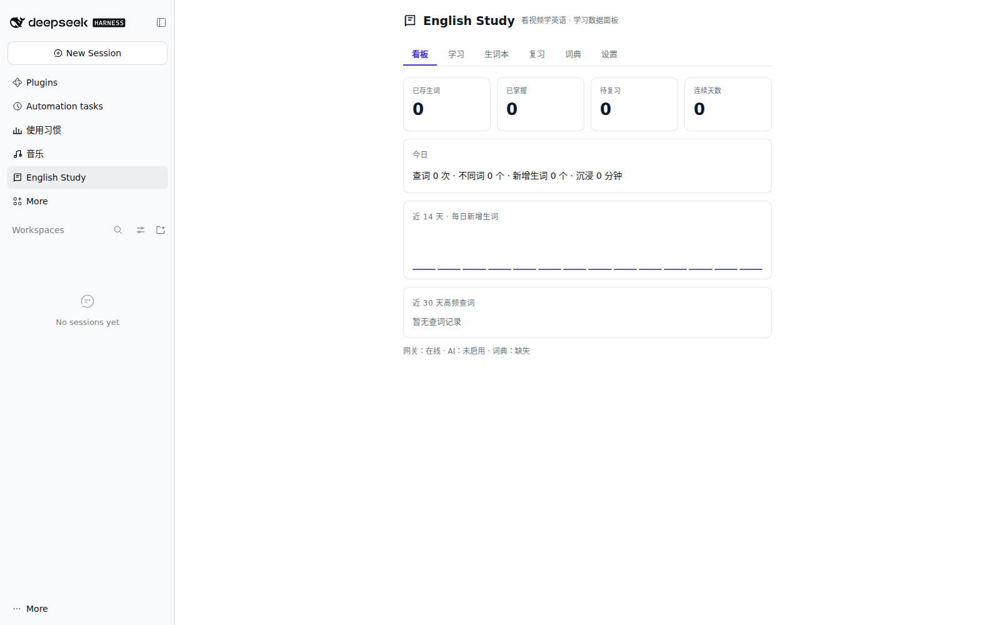
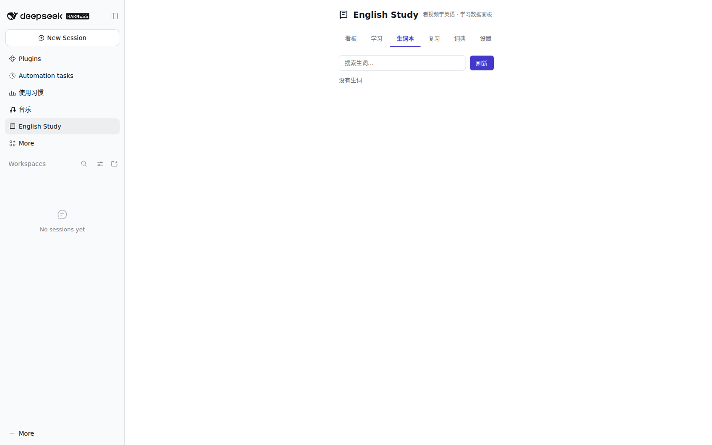
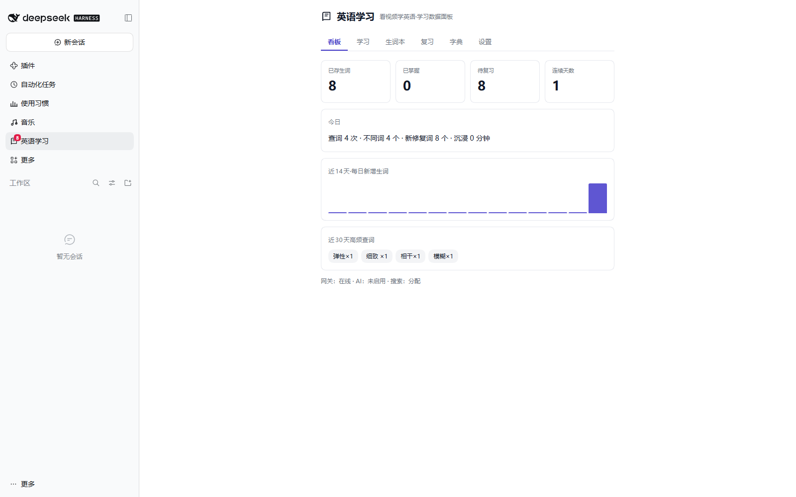
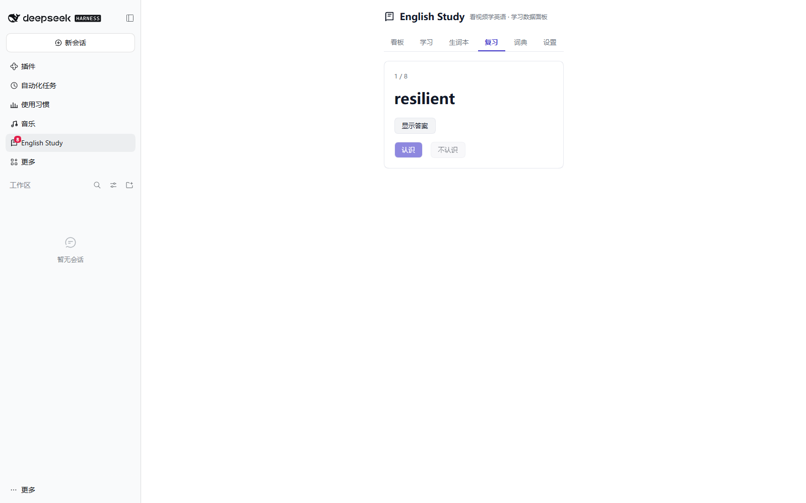
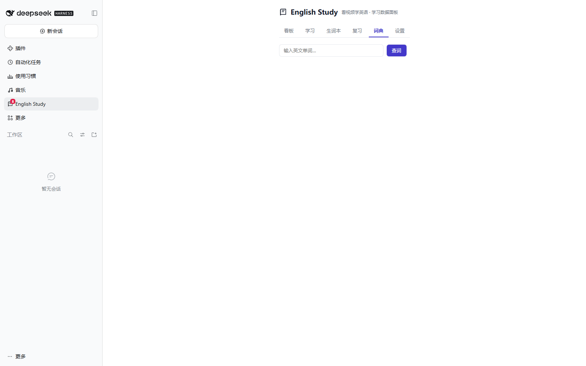

# dsh-english-study

> Learn English by actually watching YouTube — immersion time, lookup history, a vocabulary book with SM-2 spaced repetition, and a dashboard. Runs as a plugin inside **DeepSeek Harness (DSH)**. **100% local: no remote server, no cloud sync, no telemetry.**


*Dashboard on a fresh install (empty data). The footer reports gateway / AI / dictionary state.*


*Vocabulary book — empty right after install, fills up as you look words up.*

### In use


*After a few days: saved words, due count, streak, daily new-word chart and the most-looked-up words.*


*Review queue — one card at a time, `认识 / 不认识` grading drives the SM-2 schedule.*


*Dictionary tab — local lookup first; the AI explanation is optional and off by default.*

[中文说明见下方](#中文说明)

---

## What it is

A DSH plugin panel (top-left icon rail) plus a tiny Python gateway. The panel renders the dashboard, YouTube feed, vocabulary book, review queue, dictionary and reports; the gateway (stdlib-only Python, default `127.0.0.1:8788`) stores everything in local SQLite.

```
YouTube page (Edge/Chrome + ext/)  ──click a word──▶  gateway 127.0.0.1:8788  ──▶  data/*.db
DSH panel (lib/client.js) ──same-origin──▶ /dsh-english-study/api/* ──▶ gateway ──▶ data/*.db
```

The panel never talks to the gateway cross-origin: the plugin proxies `/dsh-english-study/api/*` to the upstream URL, so there is no CORS or mixed-content problem and you only change one config value to move the port.

## Features

- **YouTube in the panel** — topic-aggregated home feed, real search with paging, official `/embed/` player (videos are never downloaded), clickable subtitles.
- **Click-to-look-up** — click any word on a YouTube subtitle, the browser extension sends it (with its sentence) to your local gateway.
- **Context explanation** — *optional AI* (any OpenAI-compatible endpoint you configure). Without it the panel falls back to the **local dictionary only** and makes no network request at all.
- **Vocabulary book + SM-2** — `again / good / easy` grading, ease factor, interval, lapses, due queue with a badge count on the sidebar icon.
- **Immersion tracking** — per-day seconds watched, lookups, distinct words, streak.
- **Dashboard / reports / CSV export** — local HTML pages served by the gateway.
- **Dictation & sentence collection** — drill the words you saved, keep sentences you liked.
- **Read-only model tool** — `english_study` (`stats` / `dict` / `due`) so the agent can answer "what should I review today".

## Requirements

| | |
|---|---|
| DSH | 0.2.x desktop, Web frontend |
| Node | ≥ 20 (plugin side) |
| Python | ≥ 3.10, **stdlib only** — nothing to `pip install` |
| OS | Windows 10/11 for the full feature set (Edge auto-launch, cookie extraction). The gateway itself is cross-platform. |
| Required for subtitles | `yt-dlp` on `PATH`, **recent build**. A 2024 release fails with `Precondition check failed` / `No video formats found`; `apt` builds often cannot self-update, so grab the GitHub release binary. Without `yt-dlp` the panel still runs, but there are no clickable subtitles. |
| Required for browsing | `YT_INNERTUBE_KEY` — a YouTube web-client key. **Without it the YouTube home/search lists are empty** (the rest of the panel works). See Configuration. |
| Optional | a local proxy if YouTube is blocked where you are |

## Install

### 1. Drop the plugin into a DSH profile

Put this repository anywhere on disk (`/opt/dsh-english-study`, or `D:/plugins/dsh-english-study` on Windows). Then edit your profile — default `~/.dsh/profiles/desktop/package.json`:

```jsonc
{
  "dependencies": {
    "dsh-english-study": "file:/absolute/path/to/dsh-english-study"
  },
  "dsh": {
    "profile": {
      "bundles": [
        // ...existing entries...
        "dsh-english-study"
      ]
    }
  }
}
```

That is all. The package declares `dsh.bundle.patch` (`cordis.patch.yml`), so **being listed in `bundles` is what inserts the loader entry**. Do not also add an `insert` block for this plugin in the profile's own `cordis.patch.yml` — a duplicate loader id fails the boot check. (Only if your DSH build does not layer bundled patches, move the insert there instead of listing it in `bundles`.)

Then let DSH install the profile dependency on next start (or run the profile's own package-manager install).

> `file:` dependencies are copied into `node_modules`, not symlinked. After you edit plugin source, re-install (or re-copy) the profile dependency, otherwise you are still running the old copy.

### 2. Start the local gateway

```bash
cd dsh-english-study/gateway
python server.py            # listens on 0.0.0.0:8788
```

> ⚠️ **The gateway has no authentication.** It is meant for your own machine. Set `ES_HOST=127.0.0.1` unless you specifically want your phone on the same Wi-Fi, and **never expose port 8788 to the internet** — no router port-forwarding, no public reverse proxy.

On Windows you can double-click `start-gateway.cmd` (visible window, errors stay on screen). The plugin auto-starts the gateway when it is down, unless `ES_GATEWAY_DIR` points somewhere else:

- **Windows** — runs `start-gateway-hidden.cmd` (it sets `ES_API` / `ES_MODEL` itself).
- **macOS / Linux** — runs `python3 gateway/server.py` directly (override the interpreter with `ES_PYTHON`). Note this spawns the process with the environment it inherits, so `ES_API` / `ES_MODEL` / `ES_KEY` must already be exported if you want AI enabled.

No `pip install`, no database migration: `data/english-study.db` is created on first run.

### 3. Restart DSH

Host-side code and slot registration are collected at startup. Restart DSH, refresh the GUI, and the "English Study" icon appears in the left icon rail.

Verify (any shell, clean machine):

```bash
# 1) the gateway answers
curl -s http://127.0.0.1:8788/api/health
# {"ok":true,"ai":false,"model":"","local_only":true,"port":8788,"dict":false,...}

# 2) the plugin route is mounted inside the DSH GUI
GUI_PORT=8045   # replace with your DSH GUI port (shown in DSH settings)
curl -s "http://127.0.0.1:${GUI_PORT}/dsh-english-study/api/client-ping"
# {"ok":true,"plugin":"dsh-english-study"}
```

`"ai":false` / `"local_only":true` is the expected default state, not an error. `"dict":false` only means you have not built the dictionary yet.

## Configuration

Everything is an environment variable or a plugin config field. **Nothing is required for the core features** — the defaults work offline.

| Setting | Env var | Default | What it does |
|---|---|---|---|
| Gateway port | `ES_PORT` | `8788` | Port the Python gateway listens on. Change it here *and* in the plugin's `gateway` config. |
| Bind address | `ES_HOST` | `0.0.0.0` | `0.0.0.0` also serves your phone on the same Wi-Fi; set `127.0.0.1` to keep it local-only. |
| Gateway directory | `ES_GATEWAY_DIR` | the plugin's own folder | Where `start-gateway*.cmd` lives (used by the auto-start). |
| Upstream URL | `ES_GATEWAY` (or plugin config `gateway`) | `http://127.0.0.1:8788` | What the DSH plugin proxies `/dsh-english-study/api/*` to. |
| AI endpoint | `ES_API` | *empty* | OpenAI-compatible `/chat/completions` URL. Empty ⇒ local dictionary only. |
| AI model | `ES_MODEL` | *empty* | Model name sent to the endpoint, e.g. `deepseek-chat`. |
| AI key | `ES_KEY` (or `DEEPSEEK_API_KEY`) | *empty* | Read from the environment only; never written to disk. |
| Python interpreter | `ES_PYTHON` | `python` / `python3` | Used by the `.cmd` launchers and by the macOS/Linux auto-start — set a full path if `python` is not on your PATH. |
| Base path | plugin config `basePath` | `/dsh-english-study` | Same-origin route prefix. |
| Default tab | plugin config `defaultTab` | `dashboard` | Which panel tab opens first. |
| YouTube proxy | `ES_PROXY` | *empty* (direct) | e.g. `http://127.0.0.1:7890`; `direct` forces no proxy. |
| YouTube browse key | `YT_INNERTUBE_KEY` | *empty* | Web-client key for the InnerTube calls behind the home/search lists. Empty ⇒ those lists stay empty; subtitles and playback are unaffected. |
| Learning browser exe | `ES_EDGE` | standard Edge path | Browser used for the click-to-look-up window. |
| Learning browser profile | `ES_LEARN_PROFILE` | `~/.dsh/english-study-edge-profile` | Separate profile so extensions can load. |
| Extension folder | `ES_LEARN_EXT` | this repo's `ext/` | Loaded unpacked into the learning browser. |

### Enabling AI (optional)

```bash
export ES_API=https://api.deepseek.com/chat/completions
export ES_MODEL=deepseek-chat
export ES_KEY=sk-your-own-key          # keep it in your shell profile, never in the repo
python gateway/server.py               # health now reports "ai": true
```

Windows `cmd.exe`: use `set "ES_API=..."` instead of `export`. PowerShell: `$env:ES_API="..."`. Any OpenAI-compatible `/chat/completions` endpoint works — it does not have to be DeepSeek.

With AI enabled you additionally get: context-aware explanation (part of speech in *this* sentence, collocations, CEFR, morphology) and sentence translation. With AI disabled you still get: local dictionary lookup, vocabulary book, SM-2 review, immersion stats, dashboard — and the gateway makes zero outbound requests for those features.

### Local dictionary (optional, but recommended)

`data/dict.db` is **not** shipped (it is a 26 MB generated artifact). Build it once from [ECDICT](https://github.com/skywind3000/ECDICT) (MIT):

```bash
# 1) download ECDICT's ecdict.csv and put it in <repo>/data/ecdict.csv
# 2) run this from the repository root
python gateway/build_dict.py
```

Without it, `/api/dict` answers `{"found": false, "error": "dict-not-built"}` and lookups fall through to the AI branch (if configured).

### Browser extension

Easiest: click **open learning browser** in the panel — it launches Edge with this repo's `ext/` mounted, no command needed.

Manual route: open `edge://extensions` (or `chrome://extensions`) → enable *Developer mode* → **Load unpacked** → pick this repo's `ext/` folder. The extension only ever posts to `http://127.0.0.1:8788` (editable in its popup).

If you prefer the command line, run this from the repository root on Windows:

```bat
"%ProgramFiles(x86)%\Microsoft\Edge\Application\msedge.exe" --user-data-dir="%USERPROFILE%\.dsh\english-study-edge-profile" --load-extension="%CD%\ext" --disable-extensions-except="%CD%\ext"
```

## Data & privacy

- **No remote server.** The published version has no cloud-sync code path at all: no account, no token, no upload endpoint.
- All learning data lives in local SQLite under `gateway/../data/`: `english-study.db` (lookups, words, reviews, immersion, sentences, dictation), `dict.db` (your dictionary build), `yt-cache/`, `yt-thumbs/`.
- Outbound requests exist only for **content you asked for**: `youtube.com` / `i.ytimg.com` (feed, search, thumbnails, subtitles via `yt-dlp`) and your own AI endpoint if you configure one. Nothing is sent to the author.
- The API key stays in an environment variable: it is never written to disk, never logged, never included in errors.
- YouTube cookie extraction (optional, `GET /api/yt/login?action=extract`) shells out to `yt-dlp --cookies-from-browser`, keeps the value **in memory only**, and deletes the temp file immediately. Nothing is persisted or transmitted anywhere but YouTube.
- `data/`, `*.db`, `*.log`, `raw/` are in `.gitignore` — your own study history can never be committed by accident.

## Known limitations

- **AI is bring-your-own-endpoint.** No key is bundled; without one there is no context explanation and no translation (local dictionary only).
- **Phone access** needs `ES_HOST=0.0.0.0` and the same Wi-Fi; the gateway has no authentication, so do not expose it to the internet.
- **Windows-leaning extras.** Edge auto-launch and cookie extraction are Windows paths/behaviours; the gateway and panel otherwise run anywhere Python and Node do.
- **No Android usage backfill.** The mobile/UsageStats companion from the private version is not part of this release; immersion time comes from the panel/extension.
- **YouTube subtitles need `yt-dlp` (recommended install).** Subtitles are fetched with `yt-dlp --skip-download` (the video itself is never downloaded). Without `yt-dlp`: no clickable subtitles and no sign-in browsing — review, dictionary, immersion stats and the dashboard still work.
- **`yt-dlp` must be reasonably new.** A 2024 build fails with `Precondition check failed` / `No video formats found`; update to the current release (`yt-dlp -U`, or your package manager's newest) before blaming the plugin.
- **An empty YouTube list is usually a missing key, not a broken plugin.** Home/search go through YouTube's InnerTube API, which needs `YT_INNERTUBE_KEY`; without it you get zero items while everything else keeps working.
- **`dict.db` must be built by you** (licensing + size, see above).
- **file: dependencies are copies** — editing plugin source does not hot-reload; re-install the profile dependency and restart DSH.

## Repository layout

```
dsh-english-study/
├── index.js                 # host side: same-origin API proxy, gateway auto-start, english_study tool
├── lib/client.js            # panel UI (dashboard / learn / words / review / dict / settings)
├── cordis.patch.yml         # loader insert config
├── package.json
├── gateway/
│   ├── server.py            # stdlib HTTP + SQLite gateway (port 8788)
│   ├── build_dict.py        # ECDICT csv -> data/dict.db
│   └── web/                 # standalone dashboard / review / words / report pages
├── ext/                     # unpacked browser extension (content script, popup, manifest)
├── start-gateway.cmd        # visible launcher (no secrets inside)
├── start-gateway-hidden.cmd # silent launcher used by the plugin
├── LICENSE                  # MIT
└── README.md
```

## Troubleshooting

| Symptom | Fix |
|---|---|
| Icon missing after restart | The profile dependency was not installed, or the loader id is duplicated/missing. Check the DSH plugin log and `~/.dsh/dsh-english-study-load-logs/plugin-loaded.jsonl`. |
| Panel says gateway unreachable | Start it: `python gateway/server.py`. Check `ES_PORT` matches the plugin's `gateway` config. |
| `"ai": false` in health | Expected without `ES_API` + `ES_KEY`. That is local-dictionary mode, not an error. |
| `dict-not-built` | Build `data/dict.db` (see above). |
| Subtitles empty | Install `yt-dlp` and/or set `ES_PROXY` if YouTube is blocked. |
| Word popup empty on YouTube | Load `ext/` as an unpacked extension in the browser you actually watch YouTube in. |

## Compatibility

- DeepSeek Harness **0.2.x** desktop, Web frontend only (`dsh.client.platform: web`).
- Python **3.10+** (no third-party packages), Node **≥ 20**.
- Panel and gateway may live on different machines in principle — but there is no auth, so keep them local.

## License

MIT — see [LICENSE](LICENSE). ECDICT, if you build `dict.db` from it, is MIT as well.

---

# 中文说明

> 边看 YouTube 边学英语：沉浸时长、查词记录、生词本 + SM-2 复习、看板。作为 **DeepSeek Harness（DSH）** 的插件运行。**纯本地：不连任何远程服务器，没有云同步，没有遥测。**


*用几天之后：已存词数、待复习数、连续天数、每日新增词曲线、近 30 天高频查词。*


*复习队列：一次一张卡，`认识 / 不认识` 的判分直接驱动 SM-2 排期。*

## 这是什么

一个 DSH 插件面板（左侧图标栏）+ 一个极小的 Python 网关。面板负责看板、YouTube 首页、生词本、复习队列、词典和报表；网关（纯标准库 Python，默认 `127.0.0.1:8788`）把所有数据写进本机 SQLite。

```
YouTube 页面（Edge/Chrome + ext/）──点词──▶ 网关 127.0.0.1:8788 ──▶ data/*.db
DSH 面板（lib/client.js）──同源──▶ /dsh-english-study/api/* ──▶ 网关 ──▶ data/*.db
```

面板**不跨域直连网关**：插件把 `/dsh-english-study/api/*` 代理到上游地址，所以没有 CORS / 混合内容问题，换端口只改一个配置。

## 功能

- **面板内刷 YouTube**——主题聚合首页、真翻页搜索、官方 `/embed/` 播放器（**视频从不下载**）、可点字幕。
- **划词即查**——在 YouTube 字幕里点任意单词，浏览器扩展把单词 + 所在句发给本机网关。
- **语境解释**——**可选 AI**（你自己配 OpenAI 兼容端点）；不配就只用本地词典，且一个外部请求都不发。
- **生词本 + SM-2**——`again / good / easy` 判分、ease、间隔、lapses，待复习队列，侧栏图标带角标数。
- **沉浸统计**——每日秒数、查词数、去重词数、连续天数。
- **看板 / 周报 / CSV 导出**——网关直接提供的本地 HTML 页。
- **听写与会话本**——拿存下的词做听写，收藏喜欢的句子。
- **只读模型工具**——`english_study`（`stats` / `dict` / `due`），可以直接问「今天该复习什么」。

## 环境要求

| | |
|---|---|
| DSH | 0.2.x 桌面版（Web 前端） |
| Node | ≥ 20（插件侧） |
| Python | ≥ 3.10，**纯标准库**，不需要 `pip install` 任何东西 |
| 系统 | 完整体验（一键拉起 Edge、读浏览器 cookie）面向 Windows 10/11；网关本身跨平台 |
| 字幕需要 | `yt-dlp` 加进 PATH，且**版本要新**。2024 的版本会报 `Precondition check failed` / `No video formats found`；`apt` 装的那份往往不能自更新，去 GitHub 下 release 二进制 |
| 浏览需要 | `YT_INNERTUBE_KEY`——YouTube 网页端 key。**不填的话首页/搜索列表是空的**（面板其余部分正常）|
| 可选 | YouTube 被墙时自备代理 |

## 安装（三步）

### ① 把插件放进 DSH profile

把本仓库放到本机任意位置（如 `/opt/dsh-english-study`，Windows 上如 `D:/plugins/dsh-english-study`），然后改 profile（默认 `~/.dsh/profiles/desktop/package.json`）：

```jsonc
{
  "dependencies": {
    "dsh-english-study": "file:/absolute/path/to/dsh-english-study"
  },
  "dsh": {
    "profile": {
      "bundles": [
        // ……原有条目保持不动……
        "dsh-english-study"
      ]
    }
  }
}
```

就这些。包自带 `dsh.bundle.patch`（`cordis.patch.yml`），**写进 `bundles` 就是插入加载器条目的方式**。不要同时在 profile 自己的 `cordis.patch.yml` 里为它写 `insert`——重复的 loader id 会让启动检查失败。（只有你的 DSH 构建不叠自带补丁时，才改成把 insert 写在那里、并从 `bundles` 里去掉。）

然后让 DSH 在下次启动时安装这份 profile 依赖（或用 profile 自己的包管理器装一次）。

> `file:` 依赖是**复制**到 `node_modules`，不是软链。改了插件源码必须重新安装（或重新复制）这份依赖，否则跑的还是旧副本。

### ② 起本机网关

```bash
cd dsh-english-study/gateway
python server.py            # 监听 0.0.0.0:8788
```

> ⚠️ **网关没有任何鉴权**，它是给自己本机用的。除非你确实要让同一 Wi-Fi 的手机访问，否则把 `ES_HOST` 设成 `127.0.0.1`；**永远不要把 8788 暴露到公网**——不要做路由器端口映射、不要拿公网反代。

Windows 上也可以双击 `start-gateway.cmd`（有窗口，报错停住给你看）。网关停机时插件会自动拉起（除非 `ES_GATEWAY_DIR` 指向别处）：

- **Windows**：跑 `start-gateway-hidden.cmd`（脚本自己设 `ES_API` / `ES_MODEL`）。
- **macOS / Linux**：直接跑 `python3 gateway/server.py`（解释器可用 `ES_PYTHON` 覆盖）。注意它是继承当前环境启动的，想让 AI 生效得先自己 export `ES_API` / `ES_MODEL` / `ES_KEY`。

不需要 `pip install`、不需要建库迁移：首次运行自动创建 `data/english-study.db`。

### ③ 重启 DSH

宿主侧代码与插槽注册在启动时一次性收集。重启 DSH、刷新 GUI，左侧图标栏出现「English Study」。

自检：

```bash
# 1) 网关活着
curl -s http://127.0.0.1:8788/api/health
# {"ok":true,"ai":false,"model":"","local_only":true,"port":8788,"dict":false,...}

# 2) 插件路由已挂进 DSH GUI
GUI_PORT=8045   # 换成你自己的 DSH GUI 端口（DSH 设置里能看到）
curl -s "http://127.0.0.1:${GUI_PORT}/dsh-english-study/api/client-ping"
# {"ok":true,"plugin":"dsh-english-study"}
```

`"ai":false` / `"local_only":true` 是默认状态，不是错误；`"dict":false` 只说明你还没构建词典。

## 配置一览

全部是环境变量或插件配置字段。**核心功能零配置**，默认值即可离线跑起来。

| 配置项 | 环境变量 | 默认值 | 作用 |
|---|---|---|---|
| 网关端口 | `ES_PORT` | `8788` | Python 网关监听端口。改这里的同时要改插件 `gateway` 配置。 |
| 监听地址 | `ES_HOST` | `0.0.0.0` | `0.0.0.0` 让同一 Wi-Fi 的手机也能访问；只想本机用就设 `127.0.0.1`。 |
| 网关目录 | `ES_GATEWAY_DIR` | 插件自身目录 | `start-gateway*.cmd` 所在目录（自愈拉起用）。 |
| 上游地址 | `ES_GATEWAY`（或插件配置 `gateway`） | `http://127.0.0.1:8788` | 插件把 `/dsh-english-study/api/*` 代理到哪。 |
| AI 端点 | `ES_API` | 空 | OpenAI 兼容的 `/chat/completions` 地址。空 ⇒ 只用本地词典。 |
| AI 模型 | `ES_MODEL` | 空 | 发给端点的模型名，例如 `deepseek-chat`。 |
| AI 密钥 | `ES_KEY`（或 `DEEPSEEK_API_KEY`） | 空 | 只从环境变量读，绝不落盘、绝不进日志。 |
| Python 解释器 | `ES_PYTHON` | `python` | `.cmd` 启动脚本用它；`python` 不在 PATH 上时填完整路径。 |
| 路由前缀 | 插件配置 `basePath` | `/dsh-english-study` | 同源路由前缀。 |
| 默认标签页 | 插件配置 `defaultTab` | `dashboard` | 打开面板先看哪一页。 |
| YouTube 代理 | `ES_PROXY` | 空（直连） | 例如 `http://127.0.0.1:7890`；`direct` 强制直连。 |
| YouTube 浏览 key | `YT_INNERTUBE_KEY` | 空 | 首页/搜索走的 InnerTube 接口需要它。空 ⇒ 这两个列表是空的；字幕与播放不受影响。 |
| 学习浏览器 | `ES_EDGE` | Edge 标准路径 | 划词学习窗口用哪个浏览器。 |
| 学习浏览器用户目录 | `ES_LEARN_PROFILE` | `~/.dsh/english-study-edge-profile` | 独立 profile，才能加载扩展。 |
| 扩展目录 | `ES_LEARN_EXT` | 本仓库的 `ext/` | 以「已解压扩展」方式加载。 |

### 启用 AI（可选）

```bash
export ES_API=https://api.deepseek.com/chat/completions
export ES_MODEL=deepseek-chat
export ES_KEY=sk-你自己的key            # 放 shell profile 里，别提交进仓库
python gateway/server.py               # health 里 "ai": true
```

Windows `cmd.exe` 用 `set "ES_API=..."`；PowerShell 用 `$env:ES_API="..."`。任何 OpenAI 兼容的 `/chat/completions` 端点都行，不一定是 DeepSeek。

启用后多出：语境化解释（这个词**在这一句里**的意思、搭配、CEFR、词根词缀）、整句翻译。不启用也照样能：查本地词典、记生词、SM-2 复习、沉浸统计、看板——这些路径**一个外部请求都不发**。

### 本地词典（可选，但强烈建议）

`data/dict.db` **不随仓库发布**（26 MB 生成物）。用 [ECDICT](https://github.com/skywind3000/ECDICT)（MIT）自己构建一次：

```bash
# 1) 下载 ECDICT 的 ecdict.csv，放到 <仓库根>/data/ecdict.csv
# 2) 在仓库根目录执行
python gateway/build_dict.py
```

没有它时 `/api/dict` 返回 `{"found": false, "error": "dict-not-built"}`，查词会落到 AI 分支（如果配了 AI）。

### 浏览器扩展

最省事：点面板里的「打开学习浏览器」，它会自动带上本仓库的 `ext/` 拉起 Edge。

手动方式：打开 `edge://extensions`（或 `chrome://extensions`）→ 打开「开发者模式」→ **加载已解压的扩展** → 选本仓库的 `ext/` 目录。扩展只向 `http://127.0.0.1:8788` 发请求（地址可在它的 popup 里改）。

想在命令行里开，在仓库根目录执行（Windows）：

```bat
"%ProgramFiles(x86)%\Microsoft\Edge\Application\msedge.exe" --user-data-dir="%USERPROFILE%\.dsh\english-study-edge-profile" --load-extension="%CD%\ext" --disable-extensions-except="%CD%\ext"
```

## 数据与隐私

- **没有远程服务器。** 发布版里没有任何云同步代码路径：没有账号、没有 token、没有上传接口。
- 所有学习数据都在本机 SQLite（`gateway/../data/`）：`english-study.db`（查词、生词、复习、沉浸、句子、听写）、`dict.db`（你自己构建的词典）、`yt-cache/`、`yt-thumbs/`。
- 出站请求只发生在**你主动要的内容**上：`youtube.com` / `i.ytimg.com`（首页、搜索、缩略图、`yt-dlp` 取字幕），以及你自己配置的 AI 端点。没有任何数据发给作者。
- API key 只存在环境变量里：不写磁盘、不进日志、不出现在错误信息里。
- YouTube 登录态（可选，`GET /api/yt/login?action=extract`）通过 `yt-dlp --cookies-from-browser` 导出，**只在内存里**，临时文件读完立即删除，除了 YouTube 不发给任何一方。
- `data/`、`*.db`、`*.log`、`raw/` 已在 `.gitignore` 里——你的学习记录不可能被误提交。

## 已知限制

- **YouTube 列表空着，多半是缺 key，不是插件坏了。** 首页/搜索走 YouTube 的 InnerTube 接口，需要 `YT_INNERTUBE_KEY`；不填就是 0 条，而面板其余部分一切正常。
- **AI 要自备端点。** 仓库不带任何 key；没有 key 就没有语境解释和翻译（只有本地词典）。
- **手机端**需要 `ES_HOST=0.0.0.0` 且同 Wi-Fi；网关**没有鉴权**，不要暴露到公网。
- **偏 Windows 的附加能力**：一键拉 Edge、读浏览器 cookie 是 Windows 路径/行为；网关与面板本身有 Python + Node 就能跑。
- **没有 Android 使用时长回补。** 私有版的手机/UsageStats 采集不在本次发布里；沉浸时长来自面板与扩展。
- **YouTube 字幕要装 `yt-dlp`，而且版本要新。** 2024 的版本会报 `Precondition check failed`；`apt` 装的那份通常不能自更新。 字幕用 `yt-dlp --skip-download` 抓（视频本身从不下载）。不装 `yt-dlp`：没有可点字幕、没有登录态浏览——复习、词典、沉浸统计、看板照常可用。
- **`dict.db` 要自己构建**（体积与授权原因，见上）。
- **`file:` 依赖是副本**——改插件源码不会热更新，要重装 profile 依赖并重启 DSH。

## 仓库结构

```
dsh-english-study/
├── index.js                 # 宿主侧：同源 API 代理、网关自愈拉起、english_study 工具
├── lib/client.js            # 面板 UI（看板 / 学习 / 生词本 / 复习 / 词典 / 设置）
├── cordis.patch.yml         # 加载器 insert 配置
├── package.json
├── gateway/
│   ├── server.py            # 标准库 HTTP + SQLite 网关（端口 8788）
│   ├── build_dict.py        # ECDICT csv -> data/dict.db
│   └── web/                 # 独立看板 / 复习 / 生词本 / 周报页面
├── ext/                     # 已解压浏览器扩展（content script、popup、manifest）
├── start-gateway.cmd        # 有窗口启动（内部不含任何密钥）
├── start-gateway-hidden.cmd # 静默启动（插件自愈用）
├── LICENSE                  # MIT
└── README.md
```

## 排障

| 现象 | 处理 |
|---|---|
| 重启后没有图标 | profile 依赖没装，或 loader id 重复/缺失。看 DSH 插件日志和 `~/.dsh/dsh-english-study-load-logs/plugin-loaded.jsonl`。 |
| 面板说网关不可达 | 先起网关：`python gateway/server.py`；再核对 `ES_PORT` 与插件 `gateway` 配置是否一致。 |
| health 里 `"ai": false` | 没配 `ES_API` + `ES_KEY` 时就是这样，是本地词典模式，不是错误。 |
| `dict-not-built` | 构建 `data/dict.db`（见上）。 |
| 字幕是空的 | 装 `yt-dlp`；YouTube 不通就设 `ES_PROXY`。 |
| YouTube 上划词没反应 | 在**你实际看 YouTube 的浏览器**里把 `ext/` 作为已解压扩展加载。 |

## 兼容性

- DeepSeek Harness **0.2.x** 桌面版，仅 Web 前端（`dsh.client.platform: web`）。
- Python **3.10+**（无第三方包），Node **≥ 20**。
- 理论上面板与网关可以分机部署，但没有鉴权，建议始终本机。

## 许可

MIT，见 [LICENSE](LICENSE)。如果你用它构建 `dict.db`，ECDICT 同样是 MIT。

---

## Clean-install notes / 干净环境验收说明

- **A bare `http://127.0.0.1:<port>/` answering `401` is normal** when DSH runs as `dsh web`: the GUI is token-guarded. Use the `?token=...` URL printed at startup. `401` does **not** mean the plugin failed to load — plugin routes are served behind the same token.
  以 `dsh web` 方式运行时，GUI 带 token 鉴权，裸访问返回 **401 是正常的**，要用启动时打印的 `?token=` 链接；`401` 不代表插件没加载。
- **Verified on a clean environment** (fresh Ubuntu 24.04 + Node 24 + `@deepseek-ai/dsh`, no other plugins): the plugin loads with `failed: []`, all of its routes answer `200`, and its client bundle is present in the merged bundle.
  已在干净环境（全新 Ubuntu 24.04 + Node 24 + 单装 DSH，无其它插件）验证：插件加载 `failed: []`，所有路由 `200`，客户端 bundle 已打进合并包。
